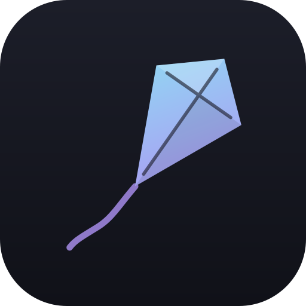
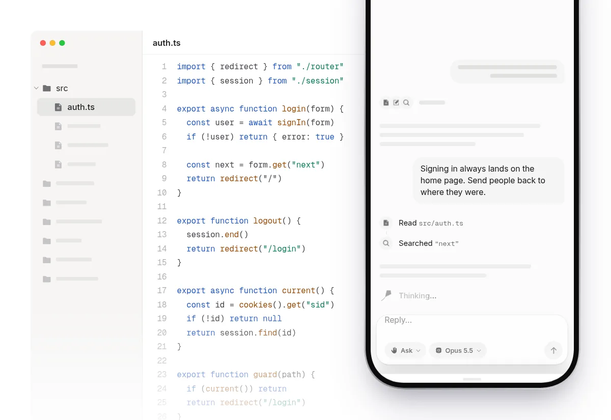

<div align="center">
  
  <h1>Kiteline</h1>
  <p><strong>Your terminal, in your pocket.</strong><br />Drive Claude Code on your computer from your phone.</p>
  <p><a href="https://sifenfisaha.github.io/kiteline/">Website</a> · <a href="#quick-start">Quick start</a> · <a href="#keeping-it-running">Run it always</a></p>
</div>

<p align="center">
  
</p>

Kiteline is a small self-hosted server and a mobile-first web app. The server runs on the computer where you use Claude Code. Your phone pairs with it once, then you can browse every session, pick one up where you left off, start new ones, and approve tool calls from wherever you are.

Claude Code does the flying, on your computer. You hold the line, from your phone. Nothing is relayed through a third party: Claude Code keeps running with your files, your settings and your login.

## What it does

- **Every session, one list.** Sessions from your terminal and from Kiteline, grouped by day, filterable by project, searchable.
- **Resume anything.** Open a session and reply. Kiteline resumes it with the full history, exactly like `claude --resume`.
- **Live streaming.** Replies stream in as they're written. Tool calls show as a tidy timeline: commands with their output, edits as diffs, file writes with syntax highlighting, sub-agents nested under their task.
- **Approve from your phone.** When Claude Code asks for permission, a sheet slides up with the exact command or diff. Allow, deny with a note, or allow it for good. Questions from Claude (`AskUserQuestion`) and plan approval (`ExitPlanMode`) get their own views.
- **Permission modes and models.** Switch between Ask, Auto-accept edits, Plan, Auto and Bypass, and between Opus, Sonnet and Haiku, mid-session.
- **Images.** Attach screenshots or photos; they're scaled down on the phone before upload.
- **Slash commands.** Type `/` for the commands your setup supports, including your own.
- **Built for a phone.** Installable as a home-screen app, safe-area aware, swipeable sheets, light and dark themes. Reconnects by itself when the phone wakes up.

## Quick start

You need Node.js 20+ and pnpm, on the computer that runs Claude Code. Claude Code must already be signed in on that machine (run `claude` once if it isn't).

```bash
git clone https://github.com/sifenfisaha/kiteline.git && cd kiteline
pnpm install
pnpm build
pnpm start
```

The server prints its addresses and a QR code:

```
  ◆  Kiteline v0.1.0

  Network  http://192.168.1.20:4545
  Local    http://localhost:4545

  Pair your phone: scan this code, or open the link on it.
  ▄▄▄▄▄▄▄ ...
```

Scan the code with your phone's camera. The page opens already paired, and the pairing lasts until you reset it.

### Reaching it from outside your home network

Your phone and computer need to see each other. On the same Wi-Fi this just works. Everywhere else, the simplest safe option is [Tailscale](https://tailscale.com): install it on both devices and Kiteline's banner will show your tailnet address too.

To install Kiteline as an app on your home screen, browsers want HTTPS. Tailscale can provide it with no certificates to manage:

```bash
tailscale serve --bg 4545
# then open https://<your-machine>.<your-tailnet>.ts.net on your phone
```

The first time, Tailscale asks you to switch on Serve and HTTPS for your tailnet; the command prints the link. Set `KITELINE_PUBLIC_URL` to that `https://` address so the pairing QR code points there.

Don't expose Kiteline's port directly to the internet.

### Keeping it running

On Linux, run Kiteline as a systemd user service so it starts at boot, restarts if it crashes, and keeps going after you log out. [`docs/kiteline.service`](docs/kiteline.service) is a template:

```bash
cp docs/kiteline.service ~/.config/systemd/user/
# edit the paths, PATH and KITELINE_PUBLIC_URL in it, then:
systemctl --user daemon-reload
systemctl --user enable --now kiteline
loginctl enable-linger "$USER"     # start at boot, before you log in
journalctl --user -u kiteline -f   # logs
```

To pair another phone while it runs in the background, run `pnpm pair`: it shows the QR code without starting a second server.

After pulling new code, run `pnpm build` and `systemctl --user restart kiteline`. Restarting stops any running sessions; they resume when you send the next message.

A laptop also has to stay awake. To keep it running with the lid closed while it's plugged in:

```bash
sudo mkdir -p /etc/systemd/logind.conf.d
printf '[Login]\nHandleLidSwitchExternalPower=ignore\n' | sudo tee /etc/systemd/logind.conf.d/kiteline-lid.conf
sudo systemctl kill -s HUP systemd-logind
```

On battery the lid still puts it to sleep.

## How it works

```
 phone (PWA)  ──HTTP + event stream──▶  Kiteline server  ──Agent SDK──▶  Claude Code  ──▶  your files
   React app        oRPC over Hono        Node, on your        one process
                                          computer             per live session
```

- The server uses the [Claude Agent SDK](https://platform.claude.com/docs/en/agent-sdk/overview) to run Claude Code. Each live session is one Claude Code process with streaming input, so follow-up messages, interrupts, mode changes and permission prompts all go to the same process.
- Permission prompts arrive through the SDK's `canUseTool` callback. The server holds the call open, pushes the request to every paired device, and answers with your decision.
- Session history is read from Claude Code's own transcripts in `~/.claude/projects`, so terminal sessions and Kiteline sessions are the same thing.
- An idle session's process is stopped after 20 minutes. The next message resumes it.

## Security

Kiteline can run commands on your computer, so treat the pairing link like a password.

- Pairing uses a random token stored in `~/.kiteline/auth.json` (mode 600). The link carries it in the URL fragment, which browsers never send to servers.
- A paired device gets an `HttpOnly`, `SameSite=Strict` cookie derived from that token. Every API call checks it; nothing works unpaired.
- Ten wrong codes from one address locks that address out for ten minutes.
- `pnpm start -- --new-token` replaces the token and unpairs every device.
- Set `KITELINE_ALLOW_BYPASS=false` to stop anyone from switching a session into bypass-permissions mode from the web.

Kiteline uses whatever credentials Claude Code on your computer uses: your claude.ai login, or `ANTHROPIC_API_KEY` if it's set. Check that the way you use it fits your plan's terms.

## Configuration

Everything has a default. Override with environment variables or `apps/server/.env`:

| Variable                | Default       | What it does                                                                                        |
| ----------------------- | ------------- | --------------------------------------------------------------------------------------------------- |
| `PORT`                  | `4545`        | Port for the server and, after a build, the web app                                                 |
| `HOST`                  | `0.0.0.0`     | Address to bind. Use `127.0.0.1` with `tailscale serve` to keep it off the LAN                      |
| `KITELINE_PUBLIC_URL`   | unset         | The address your phone uses, e.g. your `tailscale serve` HTTPS URL. The pairing QR code points here |
| `KITELINE_TOKEN`        | generated     | Fixed pairing token instead of the stored one                                                       |
| `KITELINE_HOME`         | `~/.kiteline` | Where Kiteline keeps its token and session index                                                    |
| `CLAUDE_PATH`           | bundled       | Path to a `claude` executable to use instead of the SDK's bundled one                               |
| `KITELINE_ALLOW_BYPASS` | `true`        | Whether bypass-permissions mode can be chosen from the web                                          |
| `KITELINE_MAX_SESSIONS` | `6`           | Most Claude Code processes running at once                                                          |
| `KITELINE_IDLE_MINUTES` | `20`          | Minutes before an idle session's process sleeps                                                     |
| `KITELINE_DEBUG`        | unset         | Log requests and Claude Code's stderr                                                               |

## Development

```bash
pnpm dev          # server on :4545 (watch mode), web on :4546 with hot reload
pnpm check        # Biome lint and format
pnpm check-types  # TypeScript across the workspace
```

The landing page's demo is made with [Stageshow](https://benji.org/stageshow). `pnpm --filter site dev` serves it on :4547; with that running, `node apps/site/scripts/record-demo.mjs http://localhost:4547 out` re-records the README animation (it needs Chromium and ffmpeg).

In development the QR code points at the Vite server on port 4546, which proxies `/rpc` and `/auth` to the API.

```
apps/
  server/     Hono server: pairing, oRPC endpoint, static hosting, terminal banner
  web/        React 19 + TanStack Router PWA
  site/       Landing page and the animated demo, built with Stageshow's kit
packages/
  api/        oRPC routers and the agent layer
    agent/
      run.ts        one live Claude Code process: streaming, permissions, interrupts
      manager.ts    all live runs, fan-out to devices, idle sleep
      normalize.ts  SDK messages and transcripts → the items the app renders
      history.ts    session lists and transcript pages
  ui/         Design tokens (Tailwind v4), button, bottom sheet, toasts
  config/     Shared TypeScript config
```

Built on [Better-T-Stack](https://github.com/AmanVarshney01/create-better-t-stack) (TanStack Router, Hono, oRPC, Turborepo, Biome, PWA), with [Base UI](https://base-ui.com), [Shiki](https://shiki.style), [Phosphor](https://phosphoricons.com) icons and [Inter](https://rsms.me/inter/). The design follows the craft rules of [Stageshow](https://benji.org/stageshow), whose kit draws the demo.

## Status

Kiteline is new. So far it has been tested on Linux, with Chromium at phone size. Reports from real iOS and Android devices, and from macOS and Windows hosts, are very welcome, as are issues and pull requests.

Kiteline is an independent project. It is not made by or affiliated with Anthropic.

## License

[MIT](LICENSE)
